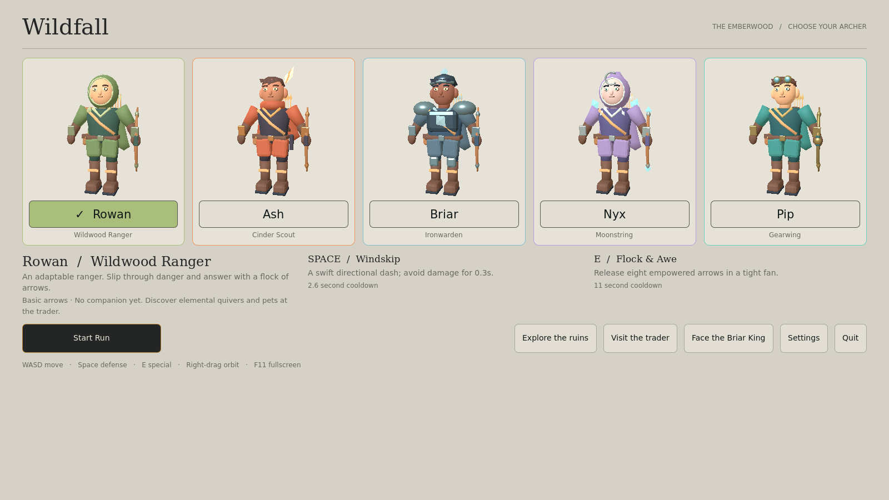
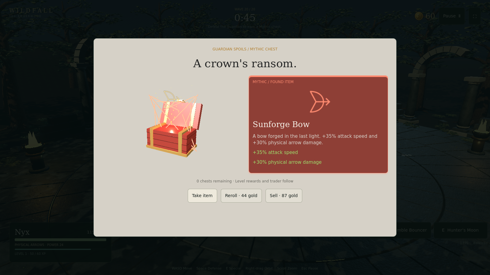

# Wildfall — The Emberwood · native campaign 0.2.1

The existing production Godot 4.6.3 game, expanded in place from main `a277452`. Native Forward+ / Metal on Mac, fullscreen by default, with the original Emberwood environment and approved trader preserved.

All five archers are unlocked for testing. Choose an archer and **Start Run**. Everyone begins with basic physical arrows and no pet. Elemental quivers and companions are purchased at the trader; the arrow readout cannot switch equipment for free.

| Archer | Identity | Space | E |
|---|---|---|---|
| Rowan | Wildwood Ranger | Windskip | Flock & Awe |
| Ash | Cinder Scout | Hare Trigger | Arrowpalooza |
| Briar | Ironwarden | Shell Yeah! | Quiverquake |
| Nyx | Moonstring | Bramble Bouncer | Hunter's Moon |
| Pip | Gearwing | Borrowed Time | Gear Expectations / Gearstorm |

The approved GLB clips animate each action. Shared grounded locomotion continues underneath bow animations, and projectile events use the authored release markers. Defensive gestures take priority when abilities overlap; missed offensive releases do not burst out during an unrelated pose. Ash and Nyx's offensive cadence respects purchased attack-speed bonuses; Pip retains the defined 0.6-second gear fan.

The selection screen uses five illustrated, animated crests instead of model previews. Each whole card selects its archer; role, kit and cooldown information remain visible below.



## Campaign and rewards

Twenty waves: ordinary waves last 45 seconds, guardian waves last 75. Guardians occur only at 5 (Briar King), 10 (Frost Oracle), 15 (Hollow Monarch), and 20 (Gilded Colossus). Their existing rigs, socket data, release timings and distinct attack designs are reused. The Colossus summons up to six living brood, in pairs from its animated chest hatch.

The wave timer determines completion. Killing a boss early does not skip the remainder of the wave. Surviving waves 5, 10 or 15 without a kill advances the campaign, but earns no Mythic chest. Wave 20 requires an actual Colossus kill for victory; surviving without it receives an explicit guardian-undefeated outcome.

Normal chests drop from non-brood monsters with 3.5% probability. All earned chests can be collected manually, and all remaining earned chests automatically collect at the boundary. Normal chests open first, followed by earned Mythic chests, then each queued level reward, then the trader. Final-wave rewards resolve before the outcome screen.

Chests use a native 3D bounce/shake/lid/rays/sparks sequence. The actual item card hops from the projected chest mouth, growing and tilting along an arc before settling upright at full size. Claim buttons unlock after the landing; normal and Mythic reveals share one animation clock. Green woodland chests and red/gold Mythic chests sit in the trader's warm neutral visual language; reward cards use its exact rarity colors. Take the item, pay for a separate escalating chest reroll, or sell it. Mythic chests come **only from boss deaths**; their premium table guarantees an eligible Mythic while one remains, then falls back to eligible rare gear. Mythics cannot be acquired twice, including through different reward sources. Recruitment and arrow-type items remain trader acquisitions.



[Native chest reveal video](preview/chest-reveal.mp4) is captured frame by frame, not a Mac performance benchmark.

## Trader and pets

The current warm page, gray/green/purple/red-orange cards, direct stat deltas, price-only purchase ribbons, red unaffordable state, hover treatment, archer coin, right stats panel and compact owned inventory remain. Bought cards leave their layout slots empty. Level reward styling and Mending Moss are preserved.

Prices are exactly `(Base + Wave + Base × .10 × Wave) × rarity × (1 + .10 × owned copies) × (1 − Economy / 100)`, rounded up once at the end. Rarity factors: 1 / 1.10 / 1.20 / 1.35. Economy caps at 40%; Merchant's Seal caps at four. Free chest copies count toward ownership and repeat pricing.

Forest Fox fires physical darts; Wild Wolf bites and slows nearby enemies with its howl; Lantern Beetle collects real ground loot and returns to the player. They act independently within a player-centered leash. Damage/cooldown upgrades require a combat pet; collection range upgrades require the beetle. Arrow swaps discard previous elemental fittings and the previous quiver while preserving shared elemental power.

Gold is deliberately limited: ordinary drops carry 2 gold and 12 XP; bosses carry 20 gold and 50 XP. Wave bounty is `12 + 2 × (wave − 1)`. Ground XP recovers fully; ground gold recovers at the build's salvage percentage. Mending Moss regenerates 1% maximum HP/second/stack only after five damage-free seconds.

## Difficulty

For `n = wave − 1`, health scales by `1 + .10n + .012n²`; damage by `1 + .06n + .015n²`. The formulas continue beyond wave 20 for future tuning, though this release ends at 20.

| Wave | HP | Damage | Living cap | Reinforcement interval | Batch |
|---|---:|---:|---:|---:|---:|
| 1 | 1.00× | 1.00× | 10 | 2.69s | 1 |
| 5 | 1.59× | 1.48× | 18 | 2.25s | 2 |
| 10 | 2.87× | 2.76× | 28 | 1.70s | 3 |
| 15 | 4.75× | 4.78× | 38 | 1.15s | 4 |
| 20 | 7.23× | 7.56× | 48 | .60s | 5 |

Elite frequency rises to 25.5% at wave 20; elites have 1.65× additional HP and 1.3× damage. Special compositions become more frequent. Boss HP uses `650 × wave HP curve × (1 + .2 × tier)`; their authored attack damage uses the wave curve with tier adjustments 1 / .9 / .8 / .7, rather than blindly multiplying demonstration HP. Armor, max HP, regeneration and avoidance remain meaningful against this steep damage curve.

## Architecture and animation diagnosis

`arena.gd` still owns the production run and combat. New focused modules are `archer_catalog.gd` / `assets/archers.json`, `archer_abilities.gd`, `pet_director.gd`, `campaign.gd`, `boss_director.gd`, `chest_rewards.gd`, and `chest_reveal.gd`. There are no five copied player controllers or twenty isolated wave scripts.

Rowan's torso ran at a fixed 2.7× animation speed while his feet advanced at travel speed / 2.2727 (2.2× at normal speed), producing a visible beat. A second velocity filter drove the feet after physical movement had already been smoothed, causing sliding. Crossing the movement threshold also switched Shoot/RunShoot and restarted crossfades mid-draw. Release sockets were sampled one step before the animation advanced.

The fix synchronizes Run with the continuous measured-distance phase, removes the extra foot-distance filter while preserving posture blending, keeps a single upper-body shot state through movement changes, and samples the release pose before projectile sockets. Approved release timestamps and Rowan's cooldowns are retained.

## Build and verification

```sh
npm run check:native
bash scripts/install-godot-native.sh
npm run build:native
```

Seven headless suites cover combat, all archer clips/release markers, run/economy/Mending Moss, motion, native settings/input, actual menu callbacks/layout, and the full campaign/reward/boss/pet integration. Validation subprocesses have timeouts so runtime script failures cannot hang the build forever. The campaign suite includes a complete 20-wave progression, both outcomes for all four guardians, stale chest claims, exact late-wave pricing, and weak-versus-defended damage checks.

`build-native-demo.mjs` exports a universal `.app` and checks both arm64 and x86_64 Mach-O slices, ad-hoc signature page hashes, the game pack, archive integrity and executable permissions. Release assets are published under a new immutable version, not over the old trial.

Balanced rendering retains the existing 1.44M-pixel 3D budget independently of the Retina HUD; High uses 2.304M and Performance .8M. Mac frame rate still needs on-device playtesting. This build is ad-hoc signed, not Apple-notarized. The included Compatibility launcher is available if required. Settings persist; unfinished runs do not persist after leaving the game. See [Mac setup and controls](MAC_README.md).

## Desktop platforms

Version 0.2.1 has separate [Mac](https://github.com/maddoxmoye/Codex/releases/tag/emberwood-mac-v0.2.1) and [Windows x64](https://github.com/maddoxmoye/Codex/releases/tag/emberwood-windows-v0.2.1) packages. The Windows ZIP is portable: extract all files and run `Wildfall-Emberwood.exe` beside its `.pck`. See [Windows instructions](WINDOWS_README.md). Linux remains a supported Godot export target but has no packaged release yet.

Windows builds run all seven validation suites, verify the exported AMD64 executable/resource pack/ZIP, then start the actual exported game headlessly on a Windows runner before publication. This verifies startup, not real GPU performance. For a slower laptop, select Settings → Performance.

Rebuild Windows with `bash scripts/install-godot-windows.sh` followed by `python3 scripts/build-native-windows.py` (Godot 4.6.3 and Node required). `native-windows.yml` handles export, Windows startup validation and publication.
